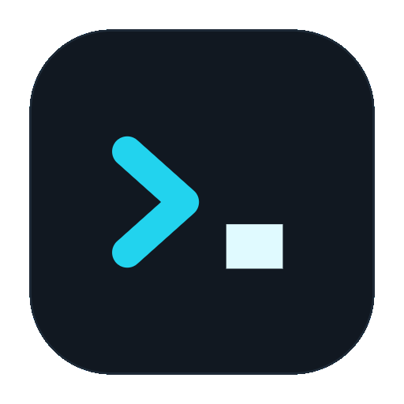

<div align="center">



# xyzterm

**a proot Linux shell in your pocket**

`terminal-only` · `no root` · `no telemetry` · `no tracking`

[](https://www.gnu.org/licenses/gpl-3.0.en.html)
[](https://f-droid.org/)
[](https://www.android.com/)
[](https://github.com/vxyzview/xyzterm/actions/workflows/android.yml)
[](.github/workflows/reproducible.yml)

<sub>Copyright © 2026 vxyzview · free software, GPL-3.0-or-later</sub>

</div>

---

## Contents

[What is xyzterm?](#what-is-xyzterm) · [Highlights](#highlights) · [Screenshots](#screenshots) · [Get started](#get-started) · [Build](#build) · [Docs](#docs) · [Privacy](#privacy) · [Credits](#credits) · [License](#license)

---

## What is xyzterm?

**xyzterm** is a minimal, terminal-only Android app that runs a **real [proot](https://github.com/termux/proot)-based Arch Linux environment** ([archm](https://github.com/vxyzview/archm)) with a full terminal emulator.

Tap the icon and you are in a shell. That's it. No code editor, no file manager, no git UI, no extension marketplace — nothing between you and the command line. If you've ever wanted a pocket Linux box that respects your attention as much as your privacy, this is it.

> The shell is the product. Everything else stays out of the way.

```console
$ pfetch
        root@localhost
    _  -----()   os      Arch Linux (archm)
   / ` ---(_)     host    arm64
  |  |   ()       kernel  5.4.210-qgki-perf
   \  ---(_)_     uptime  0m
    ` -----(_)    pkgs    371
                  memory  5682M / 7264M
```

---

## Highlights

### The terminal

- **Real Arch Linux, no root** — a proot userspace rootfs per ABI (`arm`, `arm64`) bundled inside the APK and installed on first launch. x86_64 has no archm build and is unsupported. No privileged binaries, no unlocked bootloader, no warranty voided.
- **Full terminal emulator** — configurable font, font size, cursor style, scrollback buffer, and colors.
- **Extra-keys row** — ESC / CTRL / ALT / arrows / TAB / HOME / END / PGUP / PGDN always one tap away. Fully customizable in [Termux extra-keys JSON format](https://wiki.termux.com/wiki/Touch_Keyboard#Extra_Keys_Row), with live validation while you edit.
- **Hardware keyboard support** — a wide set of default shortcuts, searchable and remappable in-app. See [KEYBINDS.md](docs/KEYBINDS.md).
- **Clipboard keybindings** — paste multi-line input safely, without auto-execution surprises.

### Sessions & data

- **Multiple named sessions** — add, rename, delete, switch from the drawer; sessions persist across restarts and survive backgrounding.
- **Custom binds** — expose any host folder inside the archm environment at a guest path of your choosing (Settings → Terminal → Custom binds).
- **Backup & restore** — export your whole sandbox (`home`, packages included) as a `.tar.gz` archive and restore it on a new device. Auto-backup supported, with managed archives pruned automatically.
- **Expose to other apps** — an optional SAF document provider lets file managers reach the sandbox.

### Look & feel

- **Terminal themes** — including pure-black **AMOLED** and Android **dynamic color (Material You)**.
- **App-wide theming** — light / dark / auto, multiple built-in themes, icon packs.
- **Minimal by design** — settings screens contain exactly what a terminal needs. Nothing else.

### Trust

- **Zero telemetry** — no analytics, no third-party crash reporting, no network calls you didn't make yourself.
- **SHA-256–verified rootfs** — the build fetches and verifies the pinned archm tarballs; first launch re-verifies the bundled copy before extracting it. No rootfs is downloaded at runtime.
- **Stable release signing** — every GitHub release is signed with the same key, so updates install in place.
- **GitHub Releases first** — the bundled rootfs makes the APK large (~428 MB with both ABIs), which may exceed F-Droid's size limits. Releases are published on [GitHub Releases](https://github.com/vxyzview/xyzterm/releases).
- **Reproducible builds** — verify our APKs match the source with [apksigcopier + diffoscope](docs/CONTRIBUTING.md).

---

## Screenshots

<div align="center">
<table>
  <tr>
    <td align="center"><br /><sub><b>Real Arch Linux shell</b> · extra-keys row</sub></td>
    <td align="center"><br /><sub><b>Type anywhere</b> · works with any keyboard</sub></td>
    <td align="center"><br /><sub><b>Named sessions</b> · switch, rename, delete</sub></td>
  </tr>
  <tr>
    <td align="center"><br /><sub><b>Clean settings</b> · only what matters</sub></td>
    <td align="center"><br /><sub><b>Themes</b> · AMOLED + Material You</sub></td>
    <td align="center"><br /><sub><b>Keybindings</b> · searchable, remappable</sub></td>
  </tr>
</table>
</div>

---

## Get started

1. Install **v1.0.0** from [GitHub Releases](https://github.com/vxyzview/xyzterm/releases/tag/v1.0.0) (F-Droid metadata is included; submission is in progress), or [build it yourself](#build).
2. Open **xyzterm** — the bundled archm rootfs extracts automatically on first launch (a one-time local setup, no download).
3. You're in a real Arch Linux shell. `pacman -Syu` if that's your thing.

> **Where are my files?** Your device storage is bound into the container — files live on normal Android storage, mounted as `/home` and `/root`.

<details>
<summary><b>First-launch tips</b></summary>

- archm installs **automatically** on first launch from the bundled asset — no network needed
- Long-press / drawer (<kbd>☰</kbd>) manages sessions — spin up one per project
- The gear icon opens terminal settings: fonts, cursor, scrollback, backups
- Broken your extra-keys JSON? The editor validates live and *Reset all* restores defaults

</details>

---

## Build

Choose one of the following build methods.

### Option 1: Build locally

Requires JDK 21 and the Android SDK. Build the **debug APK** (signed with the included test key):

```bash
./gradlew assembleDebug
```

The compiled APK lands at:

```bash
app/build/outputs/apk/debug/app-debug.apk
```

### Option 2: Build with Docker

No Android SDK or JDK 21 installed? Build in a container:

```bash
DOCKER_BUILDKIT=1 docker build --target export-stage --output ./out .
```

The generated debug APK will be located at:

```bash
out/debug/app-debug.apk
```

> Releases on GitHub Actions are built reproducibly — see [`reproducible.yml`](.github/workflows/reproducible.yml) to verify a release APK against source.

---

## Docs

- [Keybinds](docs/KEYBINDS.md) — every default shortcut and how to remap them
- [Contributing](docs/CONTRIBUTING.md) — dev setup, commit hooks, reproducible-build verification

---

## Privacy

xyzterm is built for the privacy-first crowd. It is licensed **GPL-3.0-or-later** and contains **no telemetry** and **no third-party analytics**. Your shell is your business.

---

## Support the project

If xyzterm is useful to you, consider [buying me a coffee on Ko-fi](https://ko-fi.com/vxyzview).

---

## Credits & thanks

- [Xed-Editor](https://github.com/Xed-Editor/Xed-Editor) — xyzterm started as a stripped-down fork of this project; the shared infrastructure (settings, theming) is inherited from it
- [proot](https://github.com/termux/proot) & [Termux](https://github.com/termux) — userspace rootfs magic and the terminal emulation stack
- All contributors and translators

---

## License

Copyright © 2026 vxyzview.

Distributed under the [GNU General Public License v3.0](/LICENSE), inherited from the upstream [Xed-Editor](https://github.com/Xed-Editor/Xed-Editor) project. See [COPYRIGHT](COPYRIGHT) for the copyright notice.

<div align="center">

<sub>**Your shell is your business.**</sub>

</div>
